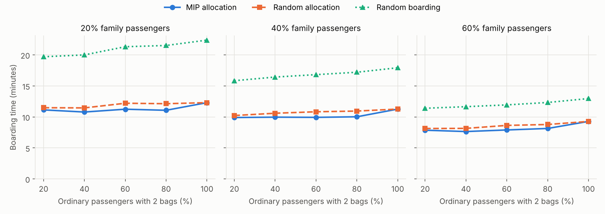
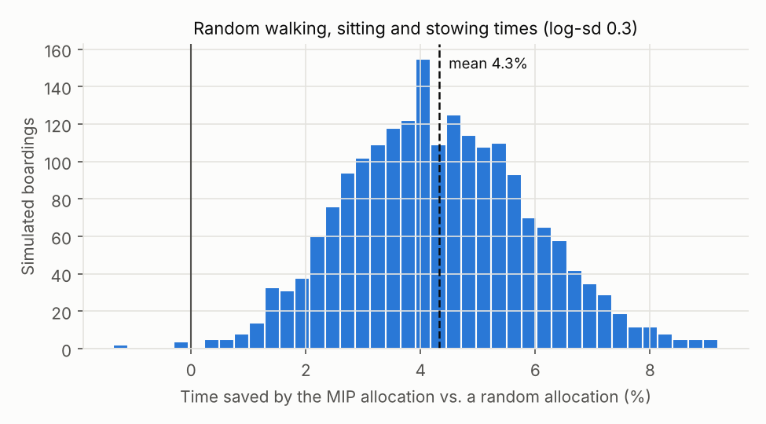

# Aircraft boarding optimisation with family passengers and hand luggage

This project uses a mixed-integer program (Python, PuLP) to decide which seat each passenger should get, based on how many bags they carry. Families are seated first, and the remaining passengers board in Steffen order. Every allocation is then timed with an event-time simulation of the aisle queue.

MSc dissertation project (*An aircraft boarding model accounting for family passengers and luggage*, MISCADA, Durham University, 2023). This repository is a clean re-implementation (2026) of the dissertation's model and experiments.

## Background

An aircraft earns nothing while it is on the ground, so airlines try hard to shorten turnaround, and boarding is one of the slowest parts of it. Two kinds of delay dominate:

* **Aisle interference:** passengers queue behind someone who is stowing luggage.
* **Seat interference:** seated passengers have to stand up to let someone reach a window or middle seat.

Earlier work used mixed-integer programming to assign seats according to how many bags each passenger carries (Milne & Salari, 2016; Salari et al., 2019). This project extends that idea to **family passengers**. Families board first and sit in seats reserved for them. The model then assigns the remaining passengers' seats, taking into account where the families sit and the bags they have already put in the overhead bins.

The dissertation asks three questions:

1. How does the amount of luggage affect boarding time?
2. Which seats should families take?
3. What changes when families of two or three sit together?

## Results

The aircraft has 20 rows, 120 seats and 3 + 3 seats per row. For each setting, 10 random instances were generated: random family seats and random family bags. Each instance compares three ways of boarding the remaining passengers:

* **MIP allocation:** Steffen boarding order, with seats assigned to passengers by the MIP according to their bags.
* **Random allocation:** the same Steffen order, with bags assigned to seats at random (200 draws). This isolates what the optimisation adds.
* **Random boarding:** random seats and a random boarding order (200 draws). This is the usual baseline in the boarding literature.

All three are timed with the same rules. Times are the averages over the instances, in seconds from the first ordinary passenger entering the cabin to the last one being seated.

### Experiment 1: amount of luggage

| Family passengers | Ordinary with 2 bags | Total bags | MIP | Random allocation | Random boarding | MIP vs random allocation | MIP vs random boarding |
|---|---:|---:|---:|---:|---:|---:|---:|
| 20% | 20% | 138 | 668 s | 689 s | 1182 s | **3.0%** | 43.5% |
| 20% | 40% | 158 | 647 s | 687 s | 1200 s | **5.8%** | 46.0% |
| 20% | 60% | 178 | 675 s | 732 s | 1279 s | **7.9%** | 47.3% |
| 20% | 80% | 197 | 664 s | 728 s | 1291 s | **8.7%** | 48.6% |
| 20% | 100% | 215 | 738 s | 738 s | 1343 s | **0.0%** | 45.0% |
| 40% | 20% | 129 | 594 s | 614 s | 950 s | **3.2%** | 37.5% |
| 40% | 40% | 150 | 598 s | 636 s | 986 s | **6.0%** | 39.4% |
| 40% | 60% | 163 | 596 s | 650 s | 1009 s | **8.3%** | 40.9% |
| 40% | 80% | 176 | 601 s | 657 s | 1032 s | **8.4%** | 41.7% |
| 40% | 100% | 193 | 676 s | 676 s | 1076 s | **0.0%** | 37.2% |
| 60% | 20% | 131 | 471 s | 488 s | 684 s | **3.4%** | 31.0% |
| 60% | 40% | 137 | 459 s | 489 s | 699 s | **6.2%** | 34.4% |
| 60% | 60% | 151 | 474 s | 518 s | 716 s | **8.5%** | 33.8% |
| 60% | 80% | 159 | 488 s | 527 s | 740 s | **7.3%** | 34.0% |
| 60% | 100% | 166 | 557 s | 557 s | 778 s | **0.0%** | 28.4% |

<p align="center"></p>

* **Most of the gain over random boarding comes from the Steffen order, not from the MIP.** Steffen order with random seat allocation is already 28–45% faster than random boarding. Choosing seats by luggage then saves a further **3–9%**.
* **The MIP helps most when the luggage mix is uneven.** If every passenger carries two bags, there is nothing to choose and the gain is exactly zero. This is a useful sanity check on the model.

### Experiment 2: family passengers in window seats (40% families)

| Family passengers in window seats | MIP | Random allocation | Random boarding | MIP vs random allocation | MIP vs random boarding |
|---|---:|---:|---:|---:|---:|
| 9 of 48 | 624 s | 662 s | 1046 s | **5.8%** | 40.3% |
| 19 of 48 | 584 s | 622 s | 957 s | **6.1%** | 39.0% |
| 28 of 48 | 531 s | 565 s | 888 s | **6.1%** | 40.2% |
| 38 of 48 | 469 s | 500 s | 813 s | **6.0%** | 42.2% |

Family passengers in window seats never have to stand up for anyone, so moving families from 9 to 38 window seats cuts boarding time by about a quarter (624 s → 469 s). The MIP's extra gain stays at about 6% throughout.

### Experiment 3: families seated together

Pairs take the window and middle seat; groups of three take a whole side of a row. Ordinary passengers: 60% carry two bags.

| Family passengers | Groups | MIP | Random allocation | Random boarding | MIP vs random allocation | MIP vs random boarding |
|---|---|---:|---:|---:|---:|---:|
| 20% | 3 pairs + 6 groups of 3 | 583 s | 638 s | 1208 s | **8.7%** | 51.8% |
| 20% | 6 pairs + 4 groups of 3 | 577 s | 632 s | 1195 s | **8.7%** | 51.7% |
| 40% | 6 pairs + 12 groups of 3 | 470 s | 523 s | 931 s | **10.1%** | 49.5% |
| 40% | 9 pairs + 10 groups of 3 | 469 s | 521 s | 909 s | **10.0%** | 48.4% |

### Robustness: random passenger times

The MIP plans with average times, but real passengers vary. For 10 instances (20% families, 40% with two bags), I re-simulated each boarding 200 times. In every run, each passenger's walking, sitting and stowing times were multiplied by independent random factors (lognormal, mean 1, log-sd 0.3). The MIP allocation was compared with a fresh random allocation under the same random times.

<p align="center"></p>

The MIP allocation was faster in **99.7%** of the 2,000 simulated boardings, by **4.3%** on average (752 s vs. 787 s).

Across all 230 instances, CBC solved the MIP to proven optimality, taking at most 2.3 s per instance. The MIP's allocation was faster than all 200 random allocations on every instance.

## Model

### Cabin, boarding order and timing

* Single aisle, one front door, 20 rows. Each side of a row has a window, middle and aisle seat.
* Family passengers board first and are already seated. Time zero is when the first ordinary passenger enters.
* Ordinary passengers board in **Steffen order**: window seats, then middle, then aisle. Within each seat type, every second row from the back, one side at a time. A passenger whose Steffen seat is taken by a family moves to the next free seat in the sequence.
* Walking one row takes T_row = 2.4 s and sitting down takes T_sit = 8 s (Milne & Kelly, 2014).
* **Stowing (Eq. 2):** T_store = (N_bin + N_bags) · N_bags / 2 · T_row, where N_bin is the number of bags already in that row's overhead bin on that side. Bags stowed earlier make the bin slower to use.
* **Seat interference (Eq. 1):** if D seated passengers sit between the aisle and your seat, sitting takes (1 + 2D) · T_sit.

### The MIP

The seats are filled in a fixed order, so the decision is **which bag count goes to which seat**. Following Milne & Salari (2016) and Salari et al. (2019), the model chooses one luggage *scenario* for each row and side: a bag count of 0, 1 or 2 for each of its free seats. A scenario fixes the order in which bags enter that bin, so every stowing time becomes a constant and the model stays linear.

```
min  T
s.t. T >= E[p, r_p]                                     every passenger p                (4)
     Σ_c X[r, s, c] = 1                                 every row r and side s           (5)
     Σ_{r,s,c} n_b(c) · X[r, s, c] = N_b                b = 0, 1, 2  (bag counts)        (6)
     E[p, r] >= E[p, r-1] + T_row                       walking                          (7)
     E[p, r] >= E[q, r] + 2 T_row                       spacing behind previous passenger (8)
     E[p, r] >= E[q', r+1] + T_row                      wait until the cell ahead is free (9)
     E[p, r_p] >= E[p, r_p - 1] + T_row + T_sit(1+2D) + Σ_c X[r_p, s_p, c] · T_store(p, c)   (10)
     E[p, r_p] >= E[q, r_p] + T_row + T_sit(1+2D) + Σ_c X[r_p, s_p, c] · T_store(p, c)       (11)
```

`E[p, r]` is the time passenger p leaves the aisle at row r. q is the previous passenger to pass through that row, and q' the previous one to pass through the next row. The equation numbers follow the dissertation.

### Simulation

Every constraint above has the form "this event happens no earlier than that one, plus a delay". So for any fixed seat allocation, the earliest possible times can be computed passenger by passenger, and the MIP's optimum is exactly that timeline. `boarding/simulate.py` computes it directly, for any boarding order, and optionally with random per-passenger times. The tests check two things:

* The simulated time of the MIP's own allocation equals the MIP objective.
* On small cabins, the MIP finds the same optimum as brute-force search over every possible allocation.

## Modelling notes

* Constraint (10) includes the T_row needed to step into one's own row.
* Constraints (8), (9) and (11) refer to the last passenger through each row, which is equivalent to comparing with all earlier passengers in a single-file aisle.
* Luggage scenarios (the dissertation's Tables 1 and 2) are enumerated directly for each row and side.
* Family passengers carry 0, 1 or 2 bags at random. Ordinary passengers carry 1 or 2 bags, with the shares of two-bag passengers used in the dissertation.

## How to run

Requires Python 3.10 or later. The code uses the PuLP 2.x API, which bundles the CBC solver; PuLP 3 and later changed the API.

```powershell
git clone https://github.com/siying0203/aircraft-boarding-optimisation.git
cd aircraft-boarding-optimisation
python -m venv .venv
.venv\Scripts\Activate.ps1          # macOS/Linux: source .venv/bin/activate
pip install -r requirements.txt

python run_experiments.py --fast    # quick check, ~30 s
python run_experiments.py           # full run, ~2 minutes; writes results/
python make_figures.py              # redraw the figures
pytest                              # unit tests
```

## Project structure

```
boarding/
  aircraft.py     cabin layout and Steffen boarding order
  timing.py       stowing and seat-interference times (Eqs. 1-2)
  simulate.py     event-time simulation of the aisle queue
  mip.py          the seat-allocation MIP (PuLP + CBC)
  scenarios.py    random instances for the three experiments
  evaluate.py     MIP vs. random allocation vs. random boarding on one instance
run_experiments.py, make_figures.py
tests/            brute-force optimality, simulation = MIP, Table 2 stowing times, ...
results/          tables, per-instance results and figures
```

## References

* Steffen, J. H. (2008). Optimal boarding method for airline passengers. *Journal of Air Transport Management*, 14(3), 146–150.
* Milne, R. J. & Kelly, A. R. (2014). A new method for boarding passengers onto an airplane. *Journal of Air Transport Management*, 34, 93–100.
* Milne, R. J. & Salari, M. (2016). Optimization of assigning passengers to seats on airplanes based on their carry-on luggage. *Journal of Air Transport Management*, 54, 104–110.
* Salari, M., Milne, R. J. & Kattan, L. (2019). Airplane boarding optimization considering reserved seats and passengers' carry-on bags. *OPSEARCH*, 56(3), 806–823.

## Licence

MIT
